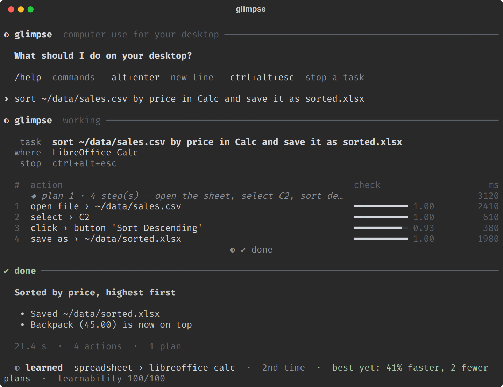

<div align="center">


# glimpse

**A computer-use harness for your Linux desktop.**
Type a task. glimpse does it in your apps, on your screen, checks the result, and learns from it.

[](LICENSE.md)
[](#requirements)
[](pyproject.toml)
[](pyproject.toml)
[](#benchmark)

[Download](#download-and-install) · [Set up](#set-up) · [Use](#use-glimpse) · [How it works](#how-glimpse-works) · [Learning](#memory-and-learning) · [Benchmark](#benchmark)

</div>

## Introduction

glimpse is a **harness**: the system around fixed models that lets them act as an agent on your desktop. It gives
the models their tools, their memory, their checks and their skills, and it improves itself after each task.

glimpse operates real apps: LibreOffice, Text Editor, Files, the web browser, Telegram and other desktop apps.
It uses the mouse, the keyboard and the accessibility tree of each app, as a person does.

Two models do the work:

- A **planner** writes the plan. You can use any OpenAI-compatible model that reads images and returns JSON.
- **Jev** (TypeSafe System One) finds each control, checks each result, and decides when the task is done.

glimpse learns from each task. When you give a similar task again, it is faster. To see how much faster, type `/learning`.

## Download and install

Run this command in a terminal:

```sh
curl -fsSL https://raw.githubusercontent.com/Viverun/glimpse-jev/main/install.sh | bash
```

Then connect your models:

```sh
glimpse setup
```

The installer does these steps:

1. It installs [`uv`](https://docs.astral.sh/uv/) if `uv` is not available.
2. It downloads glimpse to `~/.local/share/glimpse-jev`.
3. It installs the Python dependencies.
4. It puts the `glimpse` command in `~/.local/bin`.

To update glimpse, run the same command again. To download the source only, use
[the ZIP file](https://github.com/Viverun/glimpse-jev/archive/refs/heads/main.zip) or `git clone https://github.com/Viverun/glimpse-jev.git`.

<div align="center">

</div>

## Contents

- [What you can ask](#what-you-can-ask)
- [Requirements](#requirements)
- [Set up](#set-up)
- [Use glimpse](#use-glimpse)
- [Stop a task](#stop-a-task)
- [How glimpse works](#how-glimpse-works)
- [Memory and learning](#memory-and-learning)
- [Safety](#safety)
- [Benchmark](#benchmark)
- [Improve the harness (Harness²)](#improve-the-harness-harness)
- [Teach glimpse a skill](#teach-glimpse-a-skill)
- [Repository layout](#repository-layout)
- [Limitations](#limitations)
- [License](#license)

## What you can ask

```sh
glimpse "open ~/data/sales.csv in LibreOffice Calc, sort the rows by Price from high to low, save it as sorted.xlsx"
glimpse "in Writer, write a one-page summary of ~/notes/meeting.txt and export it as a PDF"
glimpse "look at my recent GitHub activity and tell me what I worked on"
glimpse "check if I have unread messages on Telegram"
glimpse "in the Files app, move all .csv files in ~/Downloads into a new folder named data"
glimpse "for 2 hours, work with Claude on my project: give it the next task each time it finishes"
```

When a task names an app, glimpse does the work in that app. It uses the shell only to check the result.

## Requirements

| You need | Why |
|---|---|
| Linux with **GNOME on Wayland** (Ubuntu, Fedora, Arch, Debian and others) | glimpse reads windows through AT-SPI and the desktop portal. |
| [`computer-use-linux`](https://github.com/agent-sh/computer-use-linux) (`npm install -g @agent-sh/computer-use-linux`) | It reads the windows and sends clicks and keys. |
| `ydotool`, with the `ydotoold` daemon running | It moves the pointer and types. |
| `gtk-launch` (package `libgtk-3-bin`) and `git` | They open apps and download glimpse. |
| A **TypeSafe API key** | Jev uses it. |
| An **OpenAI-compatible endpoint**, API key and model | The planner uses them. You do not need them with `--jev-only`. |

Optional:

- LibreOffice, for spreadsheet and document tasks.
- [Zen Browser](https://zen-browser.app/), the default browser for web tasks.
- Membership of the `input` group, for the stop key: run `sudo usermod -aG input $USER`, then log out and log in again.

glimpse does not operate Windows, macOS, KDE or X11 sessions at this time.

## Set up

Run `glimpse setup` and give these values:

| Value | Example |
|---|---|
| Planner base URL | `https://api.openai.com/v1`, or `https://<resource>.openai.azure.com/openai/v1` |
| Planner API key | your key |
| Planner model | a model that reads images and returns JSON |
| Reasoning effort | `low`, `medium`, `high`, or empty |
| TypeSafe API key | your key |
| TypeSafe base URL | empty, for the default endpoint |

glimpse tests the planner and Jev, and then it checks the desktop tools.
It saves the values in `~/.config/jev/config.json`. Only your user can read this file.

<details>
<summary>Use environment variables instead</summary>

Environment variables have priority over the file.

| Setting | Environment variables |
|---|---|
| Planner base URL | `JEV_PLANNER_BASE_URL`, `OPENAI_BASE_URL`, `AZURE_OPENAI_ENDPOINT` |
| Planner API key | `JEV_PLANNER_API_KEY`, `OPENAI_API_KEY`, `AZURE_OPENAI_API_KEY` |
| Planner model | `JEV_PLANNER_MODEL`, `AZURE_OPENAI_DEPLOYMENT` |
| Reasoning effort | `JEV_LUNA_EFFORT` |
| Service tier | `JEV_LUNA_TIER` |
| TypeSafe API key | `TYPESAFE_API_KEY` |
| TypeSafe base URL | `TYPESAFE_BASE_URL` |

</details>

To examine the setup later, run `glimpse /doctor`.

## Use glimpse

```sh
glimpse                       # open an interactive session
glimpse "open the calculator"  # do one task
glimpse -c                    # continue the last session
glimpse --resume trip         # continue a saved session (number, id or a word from its title)
```

In an interactive session:

| Key or command | Effect |
|---|---|
| Enter | Start the task |
| `/help` | Show all commands |
| ↑ and `Ctrl+R` | Find earlier tasks |
| `Alt+Enter` | Add a new line |
| `!command` | Run a shell command |
| `/learning` | Show what glimpse learned, for each kind of task |

Each task goes into a session. glimpse gives the earlier tasks of the session to the planner. Thus "now close it" works.
To give glimpse a time budget, put the time in the task, for example "for 3 hours, ...".

While glimpse works:

- A soft grey light glows around the edges of the screen. Type `/glow off` to turn it off.
- Notifications show in the top-right corner of the screen.
- If you use the keyboard or the touchpad, glimpse pauses for 10 seconds after your last input, and the light at the edges changes to red. Then glimpse looks at the screen again and continues, and the light changes back to grey. Type `continue` to continue sooner.
- To give more instructions, type them in the glimpse terminal and push Enter. glimpse uses them from its next plan. Type `stop` to stop.
- The pointer changes to the glimpse cursor ◐ and moves smoothly to each target before it clicks. Your cursor comes back when the task stops.

Options:

| Option | Effect |
|---|---|
| `--jev-only` | Do not use the planner. Jev selects each action. |
| `--max-minutes N` | Stop the task after N minutes. |
| `--block TEXT` | Do not touch windows with TEXT in the title. |
| `--quiet` | Do not show pop-ups. |
| `--confirm` | Ask before each task starts. |

## Stop a task

Push **Ctrl+Alt+Esc** in any window. glimpse stops at once.

To use a different key combination, type `/stopkey ctrl+alt+x`.
The mouse and the touchpad do not stop a task, so you can use them while glimpse works.

## How glimpse works

```
 task ──► context ──► plan ──► act ──► check ──► done
                       ▲                  │
                       └──── recover ◄────┘
```

1. **Context.** glimpse collects the open windows, the elements and the text of the active window, a screenshot, your preferences, the lessons for the app, and the best past workflow.
2. **Plan.** The planner writes the steps for the full task in one reply when it can. It also writes a check command and a report.
3. **Act.** glimpse does each step. Jev finds the element in the accessibility tree. If the tree does not show it, Jev finds it on the screenshot. The pointer moves to the element, and then the click occurs.
4. **Check.** glimpse compares the screen before and after each step. Jev examines the expected result and looks for error messages. glimpse checks files on the disk.
5. **Recover.** If a step fails, the planner gets the failure, the change on the screen and the nearest elements. Then it makes a new plan. If glimpse repeats the same actions, it tells the planner to use a different method.
6. **Done.** The task finishes only when the check command passes.

Special steps make difficult parts reliable:

| Step | Effect |
|---|---|
| `save_as` | Saves to an exact path in any format, including PDF from LibreOffice, and verifies the file. |
| `select` | Selects a range in LibreOffice Calc and verifies the selection. |
| `open_file` | Opens a file directly in an app. |
| `read_page` | Gets the full text of a public web page. |

## Memory and learning

After each task, glimpse shows what it learned:

```
◐ learned  spreadsheet › libreoffice-calc  ·  2nd time  ·  best yet: 41% faster, 2 fewer plans  ·  learnability 100/100
```

| Part | Meaning |
|---|---|
| Category | The kind of task: spreadsheet, document, files, web, email, messages, agent, system, question or other, and the app |
| Attempt | How many times glimpse did this task, or a similar task |
| Label | first time, best yet, improved, about the same, slower, or not learned |
| Learnability | 0 to 100: the task finished and passed its check, the steps were clean, there were few new plans, and a reusable workflow came from it |

After a task passes its check, glimpse makes a reusable workflow from it ([Agent Workflow Memory](https://github.com/zorazrw/agent-workflow-memory)).

When a task fails, repeats actions or is slow, glimpse improves the skill for that kind of task
(Reflect, Revise, Reuse, from [EvoSkill-GUI](https://github.com/ZJU-REAL/EvoSkill-GUI)):

1. **Reflect.** An isolated verifier examines the task, the action log and the result. It does not see the
   planner's reasoning or the skill, so it cannot be persuaded. It gives the failure type, the first wrong step,
   the root cause and changes to make.
2. **Revise.** A maintainer edits the skill: the main steps, a backup route, and recover rules ("if X, then Y").
3. **Reuse.** The next similar task gets the revised skill.
Before a new task, Jev selects the best workflow and the best past task, and the planner gets them.
If a past task was slow, glimpse gives only its workflow, not the slow steps.

glimpse keeps its memory in `~/.config/jev/`:

| File | Content |
|---|---|
| `profile.json`, `JEV.md` | Your desktop, apps, preferences and standing notes (`/remember`, `/memory edit`) |
| `memory.jsonl` | Each task, with its category, steps, failures, time and learnability |
| `workflows.json` | Reusable workflows with `{variables}` (`/workflows`) |
| `taught.json` | App lessons from demonstrations and from Harness² (`/lessons`) |
| `harness.json` | Planner notes that Harness² adopted |
| `sessions/` | Your sessions |

## Safety

- glimpse never uses WhatsApp windows, and it does not type into its own terminal.
- The shell refuses destructive commands, for example `sudo`, `rm -rf` outside `/tmp`, and disk commands.
- When a task names an app, the shell can only read. The work must occur in the app.
- Text in windows, web pages and files is data. The planner does not obey instructions in it.
- glimpse deletes the screenshots that it takes. During a task, it turns off the screenshot flash and sound, and then it restores your settings.

## Benchmark

The benchmark has 11 tasks on the live desktop: Text Editor, LibreOffice Calc and Writer, Files, and the web.
A checker examines the files on the disk or the report. The agent cannot see the checker.

```sh
uv run python bench/live_bench.py               # all tasks
uv run python bench/live_bench.py calc_sort     # some tasks
```

Do not touch the desktop while the benchmark runs. Results on the author's machine, one run of each task:

| Round | Tasks passed (work done in the named app) | Mean time | Plans for each task |
|---|---|---|---|
| 7 | 9 of 11 | 46.7 s | 4.5 |
| 10 | **11 of 11** | **28.5 s** | **3.3** |

## Improve the harness (Harness²)

`bench/harness2.py` adapts [Harness²](https://github.com/google-research/harness2) to glimpse.
The harness is the planner notes and the app lessons. The models do not change.

For each benchmark task, the script does these steps:

1. It runs the task with the current harness.
2. Two proposers read the run. INV changes the procedure. DOM changes the app knowledge. "Keep the base" is a valid answer.
3. It runs the task again with each proposal.
4. If both proposals help, it combines them and runs the task again.
5. It adopts a proposal only if the result is clearly better than the base.
6. A reflector records what each change did, and at most one lesson for later tasks.

```sh
uv run python bench/harness2.py                  # all tasks
uv run python bench/harness2.py organize         # one task
```

To run without the adopted notes, set `JEV_NO_HARNESS=1`.

## Teach glimpse a skill

`live/teach.py` teaches by demonstration. It does the steps of a skill with the glimpse executor on the live desktop.
It verifies the result on the disk. Only then does it save the skill as a lesson and a workflow.

```sh
uv run python live/teach.py                      # all skills
uv run python live/teach.py writer_pdf           # one skill
```

To add a skill, add an entry to `SKILLS` in `live/teach.py`. Give the steps, the values and a check command.
Write the variable parts as `{NAME}`. Do not put examples in lessons, because the planner copies examples exactly.

## Repository layout

| Path | Content |
|---|---|
| `install.sh` | The installer |
| `live/jev_cli.py`, `live/repl.py`, `live/sessions.py` | The `glimpse` command, the interactive session and saved sessions |
| `live/setup_wizard.py`, `live/config.py` | `glimpse setup` and the settings |
| `live/hybrid_agent.py`, `live/jev_agent.py` | The planner loop, the steps, observation and the Jev-only mode |
| `live/a11y_agent.py`, `live/cursor.py` | Accessibility tree, pointer movement, clicks and typing |
| `live/changes.py` | Screen changes and loop detection |
| `live/lo_dialog.py`, `live/gtk_dialog.py` | The save dialogs of LibreOffice and GNOME |
| `live/memory.py`, `live/evolve.py` | Memory, learning, lessons, workflows, harness notes, and skill evolution |
| `live/mascot.py`, `live/version.py` | The mascot and the version |
| `live/takeover.py`, `live/glow.py`, `live/toast.py` | The stop key, the screen glow and the pop-up cards |
| `live/teach.py` | Teaching by demonstration |
| `bench/live_bench.py`, `bench/harness2.py` | The benchmark and Harness² |
| `tests/` | Unit tests (`uv run pytest -q tests/`) |

## Limitations

- glimpse operates only GNOME on Wayland.
- The web browser does not show page text to accessibility tools. glimpse clicks web pages from the screenshot, or it reads public pages with `read_page`.
- LibreOffice has large accessibility trees. Some steps in Calc take approximately 4 seconds for a full read.
- The benchmark results come from one machine and one run of each task.
- `live/run_live.py` is an old demo. It needs an `agent_src` folder that is not in this repository.

## License

glimpse-jev uses the [PolyForm Noncommercial License 1.0.0](LICENSE.md).

You can use, change and share glimpse for noncommercial purposes. Examples are personal use, study, research,
hobby projects, and use by charities, schools and public organizations.

You cannot use glimpse or share it for a commercial purpose. Do not sell it, and do not use it in a product or a
service that earns money. For commercial use, ask the author for a different license.

Copyright 2026 Viverun.
